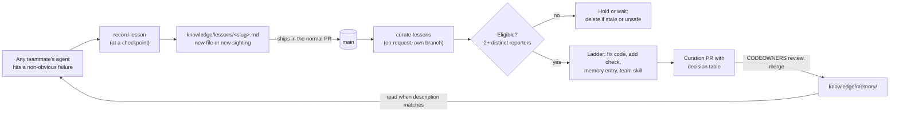

# prompt-forge: Architecture Document

## Purpose and Scope

This document describes the architecture of prompt-forge, a drop-in toolkit
that gives a team's AI coding agents a shared, reviewed memory. It is written for
contributors who need to understand why the system is shaped the way it is, and
for teams deciding whether it fits their workflow.

It follows the conventions of Architectural Decision Records (ADR) as
popularized by Michael Nygard and formalized by the MADR project. Each
architecturally significant choice is presented with its context, the options
considered, the decision, and its consequences. Superseded decisions stay in the
log with a status line, so the reasoning behind the current design remains
traceable.

The sections before the decision log describe the design as of 2.0.0.

---

## System Context

prompt-forge is not an application. It is a set of inert files that the
installer merges into a host repository, where AI coding agents interpret them
at run time.

```
Host repository
+------------------------------------------------------------------+
|  AGENTS.md            your instructions + the prompt-forge block  |
|  CLAUDE.md, GEMINI.md one-line @AGENTS.md imports                 |
|  .agents/skills/      record-lesson, curate-lessons, git-workflow,|
|                       powershell-patterns                         |
|  .claude/skills/      identical copy for Claude Code              |
|  .claude/agents/      curate-lessons subagent                     |
|  knowledge/README.md  the team's policy                           |
|  knowledge/lessons/   candidate lessons (any teammate's agent)    |
|  knowledge/memory/    verified facts (curation PRs only)          |
+------------------------------------------------------------------+
        ^ read and written by                 ^ reviewed by
        | Claude Code, Copilot, Codex,         | people, through
        | Cursor, Gemini CLI, ...              | pull requests
```

There is no runtime, server, database, or network access. The installers
(`install.sh`, `install.ps1`) run once from a clone of this repository and are
not copied into the host. The scripts under `scripts/` are maintainer tools.

---

## Architectural Principles

These principles are non-negotiable. Every decision below is evaluated against
them.

**Principle 1: Zero runtime dependencies.**
What lands in a host repository is Markdown. Installing needs git plus bash or
PowerShell, both of which a development machine already has. Nothing needs to
keep running afterwards.

**Principle 2: Host-project safety.**
prompt-forge must never break or silently overwrite a host project's files. The
installers merge marked blocks and import lines, create knowledge files only
where missing, and replace only prompt-forge's own skills, and only on an
explicit upgrade.

**Principle 3: Progressive disclosure, and a small footprint.**
Every token loaded into an agent competes with the task. Skills expose only
their name and description until a task matches. Memory files are budgeted and
read only when their description matches. Research on context files
([Gloaguen et al., 2026](https://arxiv.org/abs/2602.11988)) finds cost goes up
and success does not reliably follow, so less is the default.

**Principle 4: Git-native, reviewed knowledge.**
Knowledge is Markdown in the repository: diffable, mergeable, and reviewed like
code. A pull request is the approval mechanism and git history is the audit
trail.

**Principle 5: Agent-agnostic design.**
Instructions live in `AGENTS.md`, the cross-tool standard. Skills follow the
[Agent Skills specification](https://agentskills.io/specification) and live in
`.agents/skills/`, the location most agents read. Skills name capabilities
("the agent's file-edit tool"), not one vendor's tool names. Where a major agent
needs its own path or file (Claude Code's `.claude/skills/`, Gemini CLI's
`GEMINI.md`), prompt-forge generates a copy or a one-line shim instead of a
second source.

---

## Current Design (2.0)

### Components

| Component | Role |
|---|---|
| `AGENTS.md` block | Tells every agent to read matching memory before a task, and to run `record-lesson` at checkpoints. Lives between `<!-- prompt-forge:start -->` and `<!-- prompt-forge:end -->` so upgrades can replace it without touching the team's own text |
| `record-lesson` skill | Admission test, redaction, then creates `knowledge/lessons/<slug>.md` or appends a sighting. Writes nowhere else |
| `curate-lessons` skill | On explicit request only. Merges, screens, counts, promotes along the ladder, retires stale memory, and returns a decision table for a pull request. Never merges or pushes |
| `curate-lessons` subagent | Runs the skill in its own context in Claude Code (also read by VS Code and Cursor). Cannot ask questions, so it reports open decisions |
| `git-workflow`, `powershell-patterns` | General agent pitfalls. Shipped, versioned, and never edited by curation |
| `knowledge/README.md` | The team's policy: thresholds, budgets, cadence. Team-owned; upgrades never touch it |
| `knowledge/lessons/` | Candidates, one file per root cause, with an append-only `Sightings` list |
| `knowledge/memory/` | Verified facts, one topic per file, each with a `description` line, a budget, and `review after` dates |

### Data flow



### Token economics

| Cost | Size | When |
|---|---|---|
| Skill discovery | ~100 tokens per skill, ~400 in total | Every session, by the agent's own skill loader |
| `AGENTS.md` block | ~300 tokens | Every session |
| `record-lesson` body | ~1.1k tokens | Only when a lesson is worth recording |
| `curate-lessons` body | ~1.6k tokens | Only in a curation run, ideally in a subagent |
| `knowledge/memory/` | Budgeted at ~2k tokens in total; agents read only matching files | Per task |

1.x loaded its recording skill (~1.2k tokens) into every session. 2.0 loads no
skill eagerly, so a session that records nothing pays only for discovery and the
`AGENTS.md` block.

### Multi-developer behavior

- **New lessons** are separate files, so parallel branches do not conflict. Two
  people creating the same slug on the same day produce an add/add conflict,
  which is the right signal: merge the two sighting lists.
- **New sightings** are appended lines. Two branches adding a sighting to the
  same lesson conflict at the end of the file; keeping both lines always
  resolves it, and `merge=union` for `knowledge/lessons/*.md` makes git do that
  automatically ([team setup](docs/team-setup.md)). Counts stay correct because
  they are derived from the lines rather than stored.
- **Memory** is changed by agents only in curation runs, which land one at a
  time through CODEOWNERS review. People may delete a wrong entry in any pull
  request.

### Security

See [SECURITY.md](SECURITY.md) for the threat model. In short: lessons must be
paraphrased and redacted; lesson text is data, never instructions; the curator
rejects lessons that address the agent or ask for code execution or permission
changes; and everything an agent loads by default passes human review.

### Known limitations

- Recording depends on agents following `AGENTS.md`. No hook enforces it yet;
  the pull request checklist is the human backstop.
- Duplicate checks and the admission test are judgment calls made by a model.
  Curation review is the safety net.
- Tools that read both `.agents/skills/` and `.claude/skills/` may list skills
  twice. See [docs/known-issues.md](docs/known-issues.md).
- There is no evaluation yet of whether promoted memory improves outcomes.

### Maintenance

| Task | Command |
|---|---|
| Regenerate the Claude Code copy of the skills | `scripts/sync-template.ps1` |
| Check for drift (CI) | `scripts/sync-template.ps1 -Check` |
| Validate frontmatter, token counts, and links | `scripts/validate.ps1` |
| Test the installers | `scripts/test-install.ps1`, `bash scripts/test-install.sh` |

`metadata.tokens` is the body's character count divided by 4, rounded to 0.1k,
measured on LF line endings (`.gitattributes` enforces LF). `validate.ps1`
prints the measured value.

---

## Decision Log

### ADR-001: Markdown as the Skill Format

**Context.**
Agent Skills need a format that is human-writable, machine-parseable, and
compatible with multiple AI coding platforms. The format must support structured
metadata so agents can discover skills without loading their full content.

**Options considered.**

A. JSON or YAML files with embedded instruction text. Structured but unpleasant
to write by hand, especially for multi-paragraph instructional content.

B. Plain text files with conventions for metadata boundaries. Simple but fragile;
no standard way to separate metadata from instructions.

C. Markdown files with YAML frontmatter, following the agentskills.io standard.
Combines the readability of Markdown with the structure of YAML for metadata.
Already supported by major AI coding platforms.

**Decision.**
Use Markdown with YAML frontmatter conforming to the agentskills.io standard.

**Rationale.**
Markdown is the lingua franca of AI coding agents. Every major agent platform
reads it natively for system prompts, custom instructions, and skills. YAML
frontmatter provides a machine-parseable metadata block that agents can read in
a single token-efficient operation (`read_file` with a small line range). The
agentskills.io standard adds a `name` and `description` field that enables
progressive disclosure: the agent can scan all skill descriptions (~100 tokens
each) and load only the matching skill body (~500-1500 tokens).

**Consequences.**
Skills are easy to write, review, and version-control. The frontmatter schema
is extensible (we added `url`, `sources`, and `tokens` fields without breaking
anything). The trade-off is that YAML frontmatter parsing is slightly fragile;
a single misplaced character can break the metadata block. This is mitigated by
keeping the frontmatter minimal.

---

### ADR-002: Filesystem-Based Issue Registry

> **Amended by ADR-013 (2026-10-12).** Markdown files in git remain the store,
> but `INDEX.md` and the status folders were removed: a lesson is one file with
> an append-only list of sightings.

**Context.**
The learning loop needs persistent storage for tracking issues across
sessions. Issues must survive agent restarts, be shareable across developers,
and integrate with existing development workflows.

**Options considered.**

A. Embedded database (SQLite). Would require a runtime dependency and a schema
migration strategy. Overkill for the expected data volume (tens to hundreds of
issues, not millions).

B. External service (GitHub Issues, Jira, Linear). Would couple the toolkit to
a specific platform and require API credentials. Breaks Principle 1.

C. Markdown files in a directory structure, versioned with Git. Each issue is a
file. The index is a file. No dependencies, no credentials, no migration scripts.

**Decision.**
Store issues as individual Markdown files under `knowledge/issues/`, with an
`INDEX.md` file serving as a human-and-machine-readable catalog. Each issue file
uses YAML frontmatter for structured fields (id, occurrences, certainty) and
Markdown body for qualitative evidence.

**Rationale.**
The filesystem is the most portable database in existence. Git provides
versioning, diffing, and collaboration for free. A developer can browse issues
with any text editor, not just through the AI agent. The structure is
self-documenting: reading `INDEX.md` gives an overview; reading an individual
issue file gives the details. No schema migrations are needed because the
frontmatter format is extensible.

**Consequences.**
The index table can produce merge conflicts when two developers add rows
simultaneously. This is addressed by the UUID-based ID scheme (ADR-005) and the
conflict resolution instructions embedded in `INDEX.md`. The trade-off is
acceptable because merge conflicts on a Markdown table are trivial to resolve
compared to database migration failures or API rate limits.

---

### ADR-003: PowerShell for Session Scripts ~~(Retired)~~

> **Status: Retired (2026-08-01).** The session tracking scripts
> (`session-start.ps1`, `session-end.ps1`) were removed as part of the
> `tokenTracker` cleanup. Token counting is not reliably exposed by current
> AI coding agent APIs, making automated tracking impractical. The ADR is
> preserved for historical reference.

**Context (original).**
Token tracking requires scripts that create log files and read environment
variables. These scripts are optional; the toolkit works without them. They must
run on Windows without additional installations.

**Options considered.**

A. Python scripts. Would require Python to be installed and on PATH. Many
Windows development machines have Python, but not all. Breaks Principle 1.

B. Node.js scripts. Same dependency problem as Python, plus the overhead of npm
package management for what amounts to file I/O and date formatting.

C. Batch files (.bat or .cmd). Limited string manipulation, no native JSON
support, fragile error handling. Not appropriate for structured logging.

D. PowerShell scripts (.ps1). Preinstalled on Windows 10 and later. Native
JSON support via `ConvertFrom-Json` and `ConvertTo-Json`. Rich error handling.
Object-oriented pipeline makes data transformation straightforward.

**Decision.**
Use PowerShell 5.1 scripts for session start and end logging.

**Rationale.**
PowerShell is the only scripting runtime guaranteed to exist on every Windows
machine that runs VS Code. Its JSON handling is excellent for structured
logging. The scripts are intentionally kept under 100 lines each so they are
easy to audit and modify. The trade-off is that these scripts do not run on
macOS or Linux without installing PowerShell Core, but the toolkit's core
functionality (skills, issue registry, developer) is platform-independent
Markdown; the scripts are an optional Windows bonus.

**Consequences.**
The scripts are gone and nothing replaced them. Host projects now receive
Markdown only, which strengthens Principle 1: there is no longer any host-side
platform assumption at all. `sync-skills.ps1` remains, but as a maintainer tool
outside every package.

---

### ADR-004: Progressive Disclosure for Skill Loading

> **Amended by ADR-015 (2026-10-12).** Progressive disclosure stands, but no
> skill is loaded eagerly any more. The recording skill runs at checkpoints.

**Context.**
An AI coding agent may have access to dozens of skills in a project. Loading
all skill bodies eagerly would consume context window tokens that could be used
for the actual coding task. A mechanism is needed to defer loading until a skill
is relevant.

**Options considered.**

A. Load all skills eagerly at session start. Simple but wasteful. Every skill
body (total ~7.1k tokens across all six skills) would be loaded into every
conversation, even if none are triggered.

B. Keyword-based triggering. The agent scans user messages for keywords and
loads matching skills. Fragile; a user saying "I need to commit" might not
trigger the git-workflow skill if the keyword list is too narrow.

C. Description-based triggering using frontmatter. Each skill declares its
trigger conditions in natural language in the `description` field. The agent
reads only the frontmatter of all skills (~100 tokens each, ~500 tokens total)
and loads the full body only when the conversation context semantically matches
a description.

**Decision.**
Use description-based progressive disclosure. Each `SKILL.md` contains a
`description` field in its YAML frontmatter that describes when the skill should
be loaded. The agent reads all frontmatter blocks (approximately 600 tokens for
six skills) and loads the body of only the skills whose descriptions match the
current task context.

**Rationale.**
This is the pattern used by Codex, Claude Code, and the agentskills.io
standard. It provides the best balance of token efficiency and triggering
accuracy. Six hundred tokens is small next to the context windows of current
models. The
descriptions act as an embedding-free semantic router: the model itself
determines relevance, which is more accurate than keyword matching.

**Consequences.**
The skill author must write descriptions that accurately reflect the trigger
conditions. A poorly written description either causes the skill to be loaded
when irrelevant (wasting tokens) or not loaded when needed (missing the
opportunity to help). This is mitigated by keeping descriptions concise and
specific. The `tokens` field in frontmatter signals how much a skill costs
once triggered: a 0.5k skill like git-workflow is cheap enough that a
false-positive trigger barely matters, while a 1.8k skill like ai-engineer is
gated behind `disable-model-invocation: true` and loads only on explicit
request. Only `developer` is loaded eagerly, every session.

---

### ADR-005: UUID-Based Issue Identifiers ~~(Superseded)~~

> **Superseded by ADR-013 (2026-10-12).** A lesson is named by a slug of its
> root cause; same-day duplicates surface as an add/add conflict to merge.

**Context.**
The issue registry assigns an identifier to each issue. The initial design used
sequential numeric IDs (ISSUE-001, ISSUE-002). This created two problems: first,
the agent had to read `INDEX.md` to determine the next available number, adding
a token cost to every issue creation. Second, and more critically, two
developers running the developer skill simultaneously would both read the same highest
ID, both create a file with the same name, and produce a Git conflict.

**Options considered.**

A. Per-developer sequential IDs (ISSUE-pablodiazjorge-001). Eliminates
collisions but requires the agent to discover the developer's identity and
track per-developer sequences. Adds complexity.

B. Timestamp-only IDs (ISSUE-20260624-143000). Nearly unique but can still
collide if two developers generate an ID in the same second. Also verbose.

C. Full UUIDs (ISSUE-a1b2c3d4-e5f6-7890-abcd-ef1234567890). Collision-proof but
extremely verbose. Hard to reference in conversations.

D. Date-prefixed short UUIDs (ISSUE-YYYYMMDD-XXXX where XXXX is the first 4
hex characters of a UUID). Combines chronological grouping with collision
resistance. The date prefix makes issues sortable; 4 hex characters provide
65,536 unique values per day, making collisions virtually impossible in any
practical team size.

**Decision.**
Use ISSUE-YYYYMMDD-XXXX format, where XXXX is generated from the first 4
hexadecimal characters of a random UUID.

**Rationale.**
The date prefix provides immediate temporal context without reading the file.
The 4-character hex suffix eliminates the need to read `INDEX.md` before
creating an issue; the agent generates the ID autonomously. With 2^16 possible
suffixes per day, the birthday paradox predicts a 50% collision probability only
after approximately 300 developers create issues on the same day -- well beyond
any realistic team size. The total length (20 characters including the ISSUE-
prefix) is short enough to reference naturally in commit messages and
conversations.

**Consequences.**
Issue filenames are no longer sequentially ordered in directory listings, but
the date prefix preserves chronological sorting. The `INDEX.md` table remains
the canonical source for issue ordering and status; file listings are
supplementary. Merge conflicts on `INDEX.md` table rows are still possible but
the instructions embedded in the file tell the resolver to keep all rows from
both branches.

---

### ADR-006: Three-Occurrence Promotion Threshold ~~(Superseded)~~

> **Superseded by ADR-013 (2026-10-12).** Eligibility now counts distinct
> reporters: 2 or more people, or 3 or more sightings on 2 or more days.

**Context.**
The learning loop detects patterns -- errors, API changes, workarounds -- and
promotes confirmed patterns to persistent knowledge (skills or memory files).
A threshold is needed to separate genuine patterns from noise.

**Options considered.**

A. Promote on first occurrence. Would flood the skill and memory system with
every minor observation. Most one-off issues are not worth encoding permanently.

B. Promote on second occurrence. Still too aggressive. Two occurrences could be
coincidence, especially if they happen in the same session.

C. Promote on third occurrence. The standard heuristic in scientific and
engineering contexts: one is an anecdote, two is a coincidence, three is a
pattern.

**Decision.**
Promote issues to skills or memory after three confirmed occurrences across
sessions. Use a tiered certainty scale: low (1 occurrence), medium (2
occurrences), high (3 or more occurrences). Only high-certainty issues are
eligible for promotion.

**Rationale.**
Three occurrences strikes the balance between sensitivity and specificity. It
filters out one-off bugs that happen to look similar (false positives) while
capturing genuine recurring problems before they waste too much developer time.
The tiered scale also provides visibility: a medium-certainty issue is a
warning flag that the agent can mention to the developer without taking action.

**Consequences.**
A genuine pattern must occur three times before it is promoted. This means the
first two occurrences still cost tokens and developer time. However, the
alternative -- promoting prematurely -- would pollute the skill system with
noise, making skills less trustworthy and ultimately less useful. The
ai-engineer's cleanup phase automatically discards low-
certainty issues older than 30 days, preventing the registry from accumulating
stale single-occurrence entries.

---

### ADR-007: Category-Based Promotion Routing ~~(Superseded)~~

> **Superseded by ADR-013 (2026-10-12).** A promotion ladder (fix the code, add
> a check, write memory, create a skill) replaced the routing table. Categories
> remain only to group lessons.

**Context.**
When an issue reaches promotion threshold, the system must decide where to
store the resulting knowledge. Different types of knowledge belong in different
locations: a PowerShell pitfall should extend the powershell-patterns skill; a
library API version change should go into user memory; a project-specific quirk
should go into repo memory.

**Options considered.**

A. Promote everything to a single knowledge file. Simple but creates a
monolithic, hard-to-navigate document. Defeats the progressive disclosure
principle.

B. Let the agent decide ad-hoc where to put each promoted issue. Flexible but
inconsistent. Different agents or sessions might make different choices for the
same type of issue.

C. Define a routing table keyed by issue category. Each category maps to a
specific promotion target. The agent follows the table, ensuring consistency
across sessions and agents.

**Decision.**
Use a category routing table in `INDEX.md` that maps each issue category to a
promotion target. Categories include `library-api`, `powershell`, `framework`,
`git`, `skill-creation`, `project-specific`, and `unknown`. The routing table is co-located with
the issue index so it can evolve alongside the issue corpus.

Note that `framework` is deliberately generic. An earlier revision hardcoded
`angular`, which contradicted Principle 5 and routed to a skill that never
existed. Category names must describe a *kind* of knowledge, not one project's
stack.

**Rationale.**
Explicit routing rules make promotion behavior predictable and auditable. A
developer can look at the table and understand exactly where each type of
knowledge will end up. New categories can be added by extending the table. The
`unknown` category acts as a safety valve: issues that do not fit any known
category stay in the open state until their category is clarified.

**Consequences.**
The routing table must be maintained. If a new category of issue emerges (for
example, `docker` or `kubernetes`), the table needs a new row. This is an
intentional friction point: it forces a conscious decision about where new
knowledge types belong, rather than allowing ad-hoc scattering.

---

### ADR-008: Minimal .gitignore Footprint ~~(Retired)~~

> **Status: Retired (2026-08-09).** The shipped `.gitignore` existed to cover
> `.prompt-forge/` session logs, which no longer exist after ADR-003 was retired.
> No package ships a `.gitignore` today, and prompt-forge writes no runtime
> artifacts at all. The remaining root `.gitignore` covers only this repository's
> own editor and OS cruft. The ADR is preserved for historical reference.

**Context (original).**
prompt-forge ships with a `.gitignore` file that is copied into the host
project. An overly broad `.gitignore` would interfere with the host project's
own ignore rules. An empty `.gitignore` would cause prompt-forge's session logs
to be accidentally committed.

**Options considered.**

A. Comprehensive `.gitignore` covering common build artifacts, dependencies,
and IDE files for all popular tech stacks. Would conflict with host project
conventions and potentially mask files the host project intentionally tracks.

B. No `.gitignore` at all. Would force every user to manually add the
`.prompt-forge/` entry. Friction on setup, and some users would forget.

C. Minimal `.gitignore` covering only prompt-forge's own runtime artifacts
(the `.prompt-forge/` logs directory). The user merges this with their existing
`.gitignore` or replaces it if the project has none.

**Decision.**
Ship a `.gitignore` that contains only the `.prompt-forge/` entry, with a
comment explaining that the host project should maintain its own ignore rules
separately.

**Rationale.**
This is the only option that satisfies Principle 2 (host-project safety). The
comment educates the user about the intended usage pattern. The single entry
is trivially auditable and mergeable.

**Consequences.**
Users with existing `.gitignore` files must manually add the entry or replace
their file. The README documents this explicitly. The trade-off of a small
setup burden is worth the guarantee that prompt-forge never accidentally
excludes files the host project needs.

---

### ADR-009: Curated Skills with Role Separation

> **Amended by ADR-016 (2026-10-12).** The roles are now `record-lesson` and
> `curate-lessons`; `explore-codebase` and `skill-creator` were removed.

**Context.**
The toolkit needs an initial set of skills that demonstrate value. Too few
skills would make the toolkit feel empty. Too many would increase the
discovery token cost (each skill costs ~100 tokens for its frontmatter) and
create maintenance burden.

**Options considered.**

A. Single monolithic instruction file. No discovery overhead, but no
progressive disclosure either. The full instruction set would be loaded into
every conversation regardless of relevance.

B. Dozens of specialized skills covering every imaginable scenario. High
discovery cost and maintenance burden. Most skills would rarely trigger.

C. A small set of skills covering the most common failure modes of AI coding
agents: codebase exploration (reading too many files), Git operations
(incorrect commit formats, bad branching), the Windows shell (chaining
operators, template escaping, exit codes), and session management (not learning
from past sessions).

**Decision (original).**
Ship five skills: `auto-improve`, `explore-codebase`, `git-workflow`,
`powershell-patterns`, and `skill-creator`. A sixth, `track-tokens`, was added
and later removed -- see ADR-003.

**Evolution (2026-06-27).**
The original monolithic `auto-improve` skill was split into two specialized
roles: `developer` (always-loaded, handles issue tracking — phases 1-3) and
`ai-engineer` (on-demand subagent, handles promotion, deduplication, and
cleanup — phases 4-6). This separation follows the principle of least
privilege: the always-loaded skill is safe and non-destructive; the
destructive operations require explicit invocation.

**Current skill set (6 skills):**
`developer`, `ai-engineer`, `explore-codebase`, `git-workflow`,
`powershell-patterns`, `skill-creator`.

**Rationale.**
These six skills address the areas where AI coding agents most frequently
need guidance. Explore-codebase saves tokens by teaching efficient search
strategies. Git-workflow enforces Conventional Commits and atomic commits.
PowerShell-patterns prevents the most common Windows scripting errors.
Skill-creator enables the ai-engineer to create new skills when patterns
are promoted, and helps developers add skills manually. Developer and
ai-engineer form a two-tier learning loop: developer records issues
passively, ai-engineer curates them actively. The total discovery overhead
is approximately 600 tokens (six frontmatter blocks), which is negligible.

**Consequences.**
Areas not covered by these six skills (e.g., Docker, Kubernetes, specific
testing frameworks) rely on the learning loop to eventually generate new
skills or memory entries when patterns emerge. The skill-creator skill ensures
that when promotion targets a new skill, the creation follows the
agentskills.io spec and prompt-forge conventions consistently. The role
separation means promotion is always a conscious decision (via ai-engineer),
never an automatic side effect of issue recording. This is intentional: the
toolkit starts lean and grows organically based on actual usage, rather than
trying to anticipate every need upfront.

---

### ADR-010: YAML Frontmatter as the Extension Point

> **Amended (2026-10-12).** Top-level fields are limited to the Agent Skills
> specification, plus the `disable-model-invocation` client extension on
> `curate-lessons`. prompt-forge's own fields live under `metadata`, and
> `scripts/validate.ps1` enforces this.

**Context.**
The skill format needs to evolve over time. New fields may be added to support
new features (source attribution, version tracking, compatibility hints).
Changes must not break existing skills or require migration scripts.

**Options considered.**

A. Fixed schema with required fields. Rigid; adding a field requires updating
all existing skills simultaneously.

B. Separate metadata files (one JSON file per skill directory). Decouples
metadata from content but adds file management complexity.

C. Extensible YAML frontmatter with required and optional fields. The core
fields (name, description) are required; all others are optional and ignored
by parsers that do not recognize them.

**Decision.**
Use YAML frontmatter with only `name` and `description` as required fields.
All other fields (`license`, `metadata`, `disable-model-invocation`, and,
under `metadata`, `url`, `sources`, `tokens`, `version`) are optional. The `metadata` block itself is
a nested optional namespace for extended attributes.

**Rationale.**
This is the standard pattern for static site generators (Jekyll, Hugo) and
has proven robust over decades. Parsers that do not understand a field simply
ignore it. New fields can be added to individual skills without updating all
skills in lockstep. The `metadata` namespace provides a second level of
organization for fields that are not part of the core agentskills.io spec
but are useful for prompt-forge's own operation.

**Consequences.**
The frontmatter format has no schema validation. A typo in a field name
creates a silently ignored field rather than an error. This is mitigated by
keeping the frontmatter minimal and reviewing skill files during normal code
review. The `tokens` field, in particular, should be verified periodically
using a character-counting script as described in the maintenance section
below.

---

### ADR-011: Provider-Specific Distribution Packages ~~(Superseded)~~

> **Superseded by ADR-014 (2026-10-12)**, after being amended by ADR-012
> (2026-08-09). One template and a merging installer replaced the packages.
> Originally: the three packages became two once
> instructions moved to `AGENTS.md`. The reasoning below still holds for the
> skills and agents directories, which remain provider-specific.

**Context.**
Different AI coding agents discover skills and instructions from different
paths. GitHub Copilot loads skills from `.github/skills/` and instructions from
`copilot-instructions.md` or `.instructions.md` files. Claude Code loads skills
from `.claude/skills/` and instructions from `CLAUDE.md` at the project root.
Third-party model providers (DeepSeek V4 via extensions, OpenRouter) may not
support `copilot-instructions.md` at all but do support `.instructions.md`
files discovered by the VS Code agent host.

A single file layout cannot serve all three audiences without requiring the user
to understand these path differences and manually reorganize files after
installation, which violates the drop-in principle.

**Options considered.**

A. Single layout with documentation telling users to rearrange files per
provider. Low maintenance burden but poor user experience. Most users would
not read the documentation and would end up with skills in the wrong paths.

B. Separate Git branches per provider. Clean per-branch but impossible to
keep in sync. Changes to a skill would require three separate commits across
three branches.

C. Monorepo with duplicated skill copies in provider-specific `packages/`
directories, plus a synchronization script. Each package is a self-contained
drop-in: the user copies one directory and gets the correct file layout for
their provider. A PowerShell script keeps the copies in sync from a single
source of truth.

**Decision.**
Organize distribution into `packages/copilot/`, `packages/claude/`, and
`packages/custom/`, each containing a full copy of the skills and the
appropriate instruction files for that provider. Use `.github/skills/` and
`.github/instructions/` at the project root as the source of truth. Provide a
`sync-skills.ps1` script that copies changes from the source of truth to all
packages.

**Rationale.**
The user experience is the overriding factor. A developer using Claude Code
should copy `packages/claude/*` and have everything work without reading about
VS Code discovery paths. The maintenance cost of triplicated skill files is
paid by the prompt-forge maintainer, not by every user. The synchronization
script eliminates the risk of manual copy errors. Provider-specific
instruction files (`CLAUDE.md`) are maintained directly in their package
directory since they have no equivalent in other providers.

**Consequences.**
Adding or editing a skill requires running `sync-skills.ps1` after the change.
Forgetting to run the script leaves packages out of sync, which is detectable
by comparing file hashes. The three packages are identical copies for skills
and shared instructions; only the instruction file format and skill directory
path differ per provider. The `.gitkeep` files in `knowledge/issues/`
subdirectories must also be duplicated to ensure Git preserves empty
directories in each package.

---

### ADR-012: AGENTS.md as the Single Instruction Surface

> **Amended by ADR-014 (2026-10-12).** `AGENTS.md` remains the single source,
> now shipped as a marked block merged into the host's own file. Claude Code has
> read `AGENTS.md` natively since v2.1.277 when no `CLAUDE.md` exists; the
> `@AGENTS.md` import is kept because it works in every version.

**Context.**
By August 2026 the instruction layer had fragmented into four near-duplicate
copies of the same startup sequence: `.github/copilot-instructions.md`,
`.github/instructions/default.instructions.md`, `packages/claude/CLAUDE.md`, and
a compressed translation embedded in a JSON string inside the DeepSeek setup
guide. They had already drifted apart. Every future edit meant four edits, and
`sync-skills.ps1` covered only two of them.

Meanwhile the ecosystem converged. `AGENTS.md` is an open format stewarded by the
Agentic AI Foundation under the Linux Foundation, which agents.md reports is used by over 60k
open-source projects. VS Code reads it natively from the workspace root
(`chat.useAgentsMdFile`), as do Codex, Cursor, Windsurf, Zed, Aider and Jules.

**Options considered.**

A. Keep the per-provider files and add token substitution to `sync-skills.ps1`
so one template generates all four. Turns a copy script into a template engine
and still leaves four artifacts to debug.

B. Pick one provider's format as canonical and document the conversion. Pushes
the work onto every user and breaks the drop-in principle.

C. Adopt `AGENTS.md` as the single source. Claude Code does not read it, but
Anthropic documents the import pattern: a `CLAUDE.md` whose first line is
`@AGENTS.md`, with Claude-specific rules below. On Windows the import is the only
option, since symlinks require Administrator or Developer Mode.

**Decision.**
Adopt option C. `AGENTS.md` at the repository root is the single source of truth
for agent instructions. `CLAUDE.md` is a thin file that imports it and adds the
Claude-specific notes about native skill and subagent discovery. Delete
`copilot-instructions.md` and `default.instructions.md`.

**Rationale.**
Four copies of a startup sequence is a defect, not a feature. prompt-forge never
used `applyTo` with anything other than `"**"`, so the glob-scoping capability of
`.instructions.md` was never exercised and nothing is lost by dropping it. The
`@AGENTS.md` import is Anthropic's own documented recommendation, so the pattern
is supported rather than a workaround.

The decision also collapses the package count. Once `copilot-instructions.md` is
gone, `packages/copilot` and `packages/custom` differ by nothing, so they merge
into `packages/vscode`. The DeepSeek guide moves to `docs/`, since it documents a
third-party bug rather than shipping anything.

**Consequences.**
Users must have `chat.useAgentsMdFile` enabled in VS Code; the README says so.
The `ai-engineer` subagent now exists in both packages, in each provider's native
format, so the two agent definitions are separate sources rather than copies --
`sync-skills.ps1` mirrors `.github/agents/` to the VS Code package and
`.claude/agents/` to the Claude package. If a third provider standardizes on a
different subagent format, it gets a third source directory rather than a
conversion step.

---

### ADR-013: Lessons with Sightings, Promoted Through Pull Requests

> **Status: Accepted (2026-10-12).** Supersedes ADR-005, ADR-006, and ADR-007,
> and the `INDEX.md` part of ADR-002.

**Context.**
A review of 1.x for team use found that the registry broke down exactly where
teams differ from individuals:

- `INDEX.md` changed on almost every recording (rows, summary counts, the date),
  so it conflicted on most parallel pull requests.
- Stored counters lost updates silently. Two branches that each change
  `occurrences: 1` to `2` merge cleanly to `2`.
- `occurrences` could not tell one developer's misconfigured machine from five
  developers hitting the same pitfall.
- Approval happened in chat, from whoever was at the keyboard, with an "always
  auto-promote" escape hatch. In Claude Code the approval question could not even
  be asked, because subagents do not have the question tool.
- Promotions edited the skills prompt-forge ships, so the next upgrade erased
  them, and nothing told agents to read `knowledge/memory/` at all.

**Options considered.**

A. Keep the registry and fix the bugs: a generated `INDEX.md`, a script to
recount. Keeps three status folders and a table nobody needs, and adds a
dependency on running the script.

B. Move the registry to an issue tracker. Breaks Principle 1 and Principle 5.

C. One file per lesson with an append-only list of sightings; no index and no
status folders; counts derived from the sightings; promotion through a pull
request; memory budgeted and read on demand.

**Decision.**
Option C.

- A lesson is `knowledge/lessons/<slug>.md` with a fixed frontmatter and a
  `Sightings` list of `date | @reporter | branch | agent | symptom` lines.
- A lesson is eligible with 2 or more distinct reporters. A single reporter's
  lesson is held, however often it recurs, unless a person fast-tracks it. Teams
  can change this in `knowledge/README.md`.
- The curator takes the cheapest durable fix (code, then a check, then memory,
  then a skill), works on its own branch, and reports a decision table. Merging
  the pull request is the approval.
- Promoted or rejected lessons are deleted; git history is the archive. A lesson
  whose fix was proposed (code or a check) keeps a `fix:` field until the fix
  lands.
- Memory files carry a `description` line and `review after` dates, within a
  budget. `AGENTS.md` tells agents to read the files that match their task.

**Rationale.**
Appended lines merge predictably (both sides are kept, by hand or with
`merge=union`), and deriving counts from lines makes lost updates impossible. Counting distinct reporters matches
what a team cares about: a problem that costs several people time. Review through
pull requests uses machinery every team already trusts, works the same for
every agent, and records who approved what. The ladder and the budget answer the
evidence that context files are costly and often unhelpful.

**Consequences.**
`INDEX.md`, the status folders, `certainty`, `created_by`, and `reviewed_by` are
gone. There is no single table of all lessons; listing the directory and reading
the frontmatter replaces it. A team that never curates accumulates candidate
lessons, but they cost nothing at run time because agents do not read
`knowledge/lessons/` by default.

---

### ADR-014: One Template, `.agents/skills/`, and a Merging Installer

> **Status: Accepted (2026-10-12).** Supersedes ADR-011. Amends ADR-012.

**Context.**
1.0.0 shipped three packages (`packages/copilot`, `packages/claude`, and
`packages/custom`), later reduced to two (`packages/vscode` with
`.github/skills/`, `packages/claude` with `.claude/skills/`), each installed with
a recursive copy. By late 2026:

- `.agents/skills/` had become the cross-tool location, read by Codex, Copilot
  and VS Code, Cursor, Gemini CLI, OpenCode, Zed, and others. Codex and Cursor
  never read `.github/skills/`, so the "VS Code package" did not reach them.
- Claude Code still reads skills only from `.claude/skills/`. It reads a root
  `AGENTS.md` natively since v2.1.277, but only when there is no `CLAUDE.md`.
- A mixed team needs both layouts in the same repository, which two exclusive
  packages could not provide.
- The recursive copy silently overwrote an existing `AGENTS.md` or `CLAUDE.md`,
  and on upgrade it reset the registry and erased promotions.

**Options considered.**

A. Keep two packages and document combining them. Pushes the problem onto every
user.

B. One layout using symlinks from `.claude/skills/` to `.agents/skills/`.
Symlinks need Developer Mode or Administrator rights on Windows, and Claude
Code's documentation advises against them there.

C. One template with `.agents/skills/` as the source and a generated,
byte-identical `.claude/skills/` copy, installed by scripts that merge instead of
copying.

**Decision.**
Option C. `template/` is exactly what a project receives.
`template/.agents/skills/` is the source of truth;
`scripts/sync-template.ps1` regenerates the Claude Code copy, and CI fails on
drift. `CLAUDE.md` and `GEMINI.md` are one-line `@AGENTS.md` shims. The
installers merge the `AGENTS.md` block between markers, append import lines,
create knowledge files only where missing, and replace prompt-forge's own skills
only with `--upgrade`. Both installers share one test plan that runs in CI on
Linux, macOS, and Windows.

The VS Code `.agent.md` definition of the curator was dropped. VS Code and
Cursor both read `.claude/agents/`, and agents without a subagent format run the
skill directly.

**Consequences.**
One install covers Claude Code, Copilot, Codex, Cursor, Gemini CLI, and the
other `.agents/skills/` readers. Tools that read both skill directories may list
each skill twice; `--skip-claude` avoids it for teams without Claude Code. The
installers are now code that must be maintained on two shells, which the shared
test plan keeps honest.

---

### ADR-015: Record at Checkpoints, Not by an Always-Loaded Skill

> **Status: Accepted (2026-10-12).** Amends ADR-004.

**Context.**
1.x loaded the `developer` skill at the start of every session and asked the
agent to run it "at the end of every significant iteration". No skill can force
itself to load; "end of iteration" is not an event a model can observe; and the
body cost about 1.2k tokens in every session, far from the moment it was needed
and often lost to context compaction.

**Options considered.**

A. Keep eager loading. Costly and unreliable.

B. Lifecycle hooks (stop or session-end events). Deterministic, but each agent
has its own format; hooks run code on teammates' machines; and session-end hooks
in several agents cannot prompt the model at all.

C. Tie recording to checkpoints the model does see (before a commit, before a
pull request, when reporting a task as done) through the `AGENTS.md` block and
the `git-workflow` skill, with a pull request checklist line as the human
backstop. Keep hooks as a later, optional layer.

**Decision.**
Option C. `record-lesson` is an ordinary model-invocable skill whose description
names those checkpoints, and it applies an admission test so that "no lesson" is
the common outcome.

**Consequences.**
Sessions that record nothing pay only for skill discovery. Recording still
depends on the model following instructions, so the [roadmap](ROADMAP.md) keeps
optional hooks as the next step.

---

### ADR-016: Verb Names for the Roles, and Fewer Generic Skills

> **Status: Accepted (2026-10-12).** Amends ADR-009.

**Context.**
`developer` and `ai-engineer` read as personas: "ai-engineer" sounds like an
agent that builds AI systems. Of the generic skills, `explore-codebase` rested on
an unsourced "91% savings" figure and duplicated what current agents do
natively, and `skill-creator` contained specification errors and shared its
name with skills that Anthropic and Codex ship, where project-level skills take
precedence.

**Decision.**
Rename the roles `record-lesson` and `curate-lessons`. Remove
`explore-codebase`. Fold the corrected skill-writing guidance into
`curate-lessons/references/writing-skills.md`, loaded only when a lesson is
promoted to a skill. Keep `git-workflow` and `powershell-patterns`, corrected
against primary sources and focused on what agents get wrong.

**Consequences.**
Four skills instead of six. The registry was empty in every known installation,
so this was the cheapest moment to rename. Upgraders follow
[docs/upgrading.md](docs/upgrading.md); the installer lists 1.x leftovers rather
than deleting them.

---

## References

- Architectural Decision Records: https://adr.github.io/
- MADR: https://adr.github.io/madr/
- Agent Skills specification: https://agentskills.io/specification
- AGENTS.md: https://agents.md/
- Claude Code memory and `AGENTS.md`: https://code.claude.com/docs/en/memory
- Claude Code skills: https://code.claude.com/docs/en/skills
- Claude Code subagents: https://code.claude.com/docs/en/sub-agents
- VS Code agent skills: https://code.visualstudio.com/docs/agent-customization/agent-skills
- Codex skills: https://learn.chatgpt.com/docs/build-skills
- Gemini CLI `GEMINI.md`: https://geminicli.com/docs/cli/gemini-md/
- Gloaguen et al., "Evaluating AGENTS.md": https://arxiv.org/abs/2602.11988
- Conventional Commits 1.0.0: https://www.conventionalcommits.org/en/v1.0.0/
